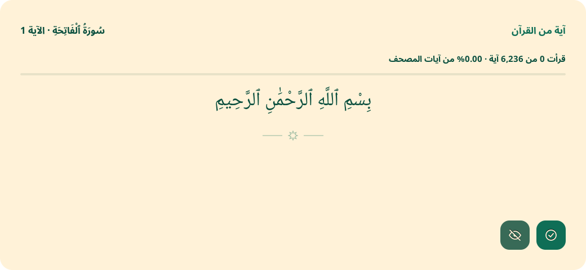

# Jisr Quran Reminder

An offline Quran reminder for Linux. A cream and green card shows one complete
ayah, saves your reading progress, and returns five minutes after you dismiss it.

[العربية](README.ar.md)



## Ubuntu + GNOME + Wayland

The GNOME backend uses a local GNOME Shell extension, rather than a regular app
window. It can display the card above applications without grabbing keyboard
focus. The Python service handles the timer and saved progress over the user's
session D-Bus. No external service or network access is needed at runtime.

GNOME Shell **45–50** is targeted (including Ubuntu 24.04's GNOME 46).
GNOME 42–44, including Ubuntu 22.04's default desktop, is not supported by this
extension. Use a newer GNOME release, or the X11 backend on a compatible session.

```sh
sudo apt update
sudo apt install git python3 python3-gi python3-gi-cairo gir1.2-gtk-3.0 gir1.2-gtklayershell-0.1 librsvg2-common fonts-noto-core
git clone https://github.com/Elgedawy31/quran-reminder.git
cd quran-reminder
./install.sh
```

On the first installation, **log out and log back in**, then enable the extension:

```sh
gnome-extensions enable jisr-quran@elgedawy31.github.io
~/.local/bin/jisr-quran --show
```

The extension can also be enabled in GNOME's Extensions app. The installer tries
to enable it immediately, but GNOME on Wayland may need a new login to discover
new extensions. The backend alone does not display a card until the extension is
enabled. Extension versions 45–50 are compatibility targets, not a claim that
every distribution and shell version has been tested.

## Other Linux desktops and distributions

| Desktop/session | Automatic backend | Notes |
| --- | --- | --- |
| GNOME 45–50, Wayland or X11 | GNOME Shell extension | Enable the local extension after installation |
| niri, Sway, Hyprland, KDE Plasma on Wayland | GTK Layer Shell | Compositor must support `zwlr_layer_shell_v1` |
| Xfce, Cinnamon, MATE, KDE on X11 | GTK window | Requests centering, keep-above and no keyboard focus |
| Other Wayland desktops | Manual `window` backend | Window positioning/keep-above depend on the compositor |

**Requirements:** Python 3.10+, a graphical Linux desktop, systemd user services,
session D-Bus and PyGObject. GTK frontends also need GTK3, PyCairo, SVG support and
Arabic fonts. Minimal installations without systemd, or distributions such as
NixOS with special packaging, need their own integration.

On Ubuntu/Debian, Fedora or Arch and derivatives, install the system packages with:

```sh
git clone https://github.com/Elgedawy31/quran-reminder.git
cd quran-reminder
./scripts/install-deps.sh
./install.sh
```

`git` is needed for cloning; install it using your distribution's package manager
first if necessary. `install-deps.sh` uses apt, dnf or pacman and may ask for sudo.
On Arch, it performs a full system upgrade to avoid partial upgrades. The
application itself installs per user and never needs root.

Backend selection is automatic. An explicit override is available:

```sh
./install.sh --backend gnome
./install.sh --backend layer-shell
./install.sh --backend window
```

The ordinary-window backend also runs on Wayland, but only the GNOME extension
and Layer Shell frontends provide compositor-level overlay behavior.

### Download without Git

Download `quran-reminder-0.1.0.tar.gz` and `SHA256SUMS` from
[Releases](https://github.com/Elgedawy31/quran-reminder/releases/latest), then:

```sh
sha256sum --ignore-missing -c SHA256SUMS
tar -xzf quran-reminder-0.1.0.tar.gz
cd quran-reminder-0.1.0
./scripts/install-deps.sh
./install.sh
```

GNOME users still need the extension activation step above. The separate
extension ZIP requires the Python backend from the main package.

## Behavior

- First launch shows the current verse immediately.
- **Read** records the verse and hides the card. The next verse appears after
  a full five minutes, in Quran order.
- **Hide** does not record reading. The same verse returns after five minutes.
- A visible card is never replaced by the timer.
- Progress survives logout, upgrades and restarts. It never wraps after the last ayah.
- Long ayahs scroll; no text is truncated or generated.
- GNOME disables the extension while the screen is locked. No reading is recorded
  while the frontend is disconnected; the frontend reconnects after unlock.
- The original niri / Layer Shell frontend remains available.

## Controls

The application launcher includes **Quran Reminder** and **Quran Reminder Stop**.

```sh
~/.local/bin/jisr-quran --show    # Enable reminders and show the current ayah
~/.local/bin/jisr-quran --hide    # Hide without marking it read
~/.local/bin/jisr-quran --stop    # Stop now and stay stopped after login
~/.local/bin/jisr-quran --start   # Enable reminders again
~/.local/bin/jisr-quran --status
```

Edit `~/.config/jisr-quran/config.json` to change the interval (seconds; minimum 10):

```json
{"interval_seconds": 300, "enabled": true, "backend": "auto"}
```

Restart the service to apply a backend change or start the new interval immediately:

```sh
systemctl --user restart jisr-quran.service
```

Configuration and state follow `XDG_CONFIG_HOME` and `XDG_STATE_HOME` when set.
Reading progress normally lives in `~/.local/state/jisr-quran/state.json`.
Application files normally live in `~/.local/share/jisr-quran/`.
Installation uses your system's Python and GI packages; do not use `sudo ./install.sh`.

## Updating and uninstalling

```sh
git pull --ff-only
./install.sh
systemctl --user restart jisr-quran.service
```

After updating extension JavaScript, log out and back in so GNOME loads the new
version. Installing/updating preserves configuration and reading progress.

```sh
./install.sh --uninstall
```

Uninstall removes application files, launchers, autostart and the local extension;
it keeps your config and reading progress. To install files without contacting a
running desktop session, use `./install.sh --no-start`.

## Troubleshooting

```sh
systemctl --user status jisr-quran.service
journalctl --user -u jisr-quran.service -b --no-pager
gnome-extensions info jisr-quran@elgedawy31.github.io
```

If status says `frontend_connected: false`, enable the GNOME extension and check
its error status. Installing GTK Layer Shell cannot make GNOME support that
protocol; GNOME needs the extension backend.

## Development

Branches: `feat/ubuntu-gnome-wayland` introduces the GNOME frontend;
`feat/linux-portability` adds the cross-distribution installer, X11 frontend,
archives and CI. `main` combines the supported features. `legacy/niri` preserves
the original local niri version.

```sh
python3 -m unittest -v test_progress
dbus-run-session -- python3 -m unittest -v test_gnome_backend
```

The D-Bus tests use temporary XDG directories and a separate session bus. The
original `test_popup.py` needs a running compositor with Layer Shell support.

Additional checks:

```sh
python3 -m unittest -v test_install
xvfb-run -a python3 -m unittest -v test_window
```

CI also starts a real headless GNOME 46 Wayland compositor and tests the extension,
its two buttons, full text, centering and reconnection after disable/enable. Run
that test only in a disposable CI/container environment:

```sh
JISR_RUN_GNOME_SMOKE=1 dbus-run-session -- python3 tests/gnome_smoke.py
```

Validated locally on Ubuntu 24.04 with GNOME Shell 46.0 / Mutter 46.2, plus GTK3
under Xvfb. Fedora and Arch dependency recipes are provided; they have not been
tested here on full desktop installations. Build distribution archives with
`python3 scripts/package.py 0.1.0`.

## Data and license

All **6,236 ayahs** and Al-Muyassar tafsir are cached in `data/verses.json`.
The current UI displays Quran text only. The downloader joins the editions by
global ayah number and checks surah/ayah references.

- Source: [Al Quran Cloud](https://alquran.cloud/api)
- Text edition: `quran-uthmani`
- Tafsir edition: `ar.muyassar`

Refreshing data is explicit, never done by the reminder:

```sh
python3 download_data.py data/verses.json
```

Application code is GPL-3.0-or-later; see [LICENSE](LICENSE). Quran and tafsir data
are attributed to the sources above and are not relicensed by the code license.
